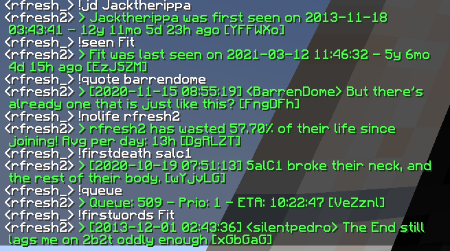

# ZenithProxy 2b2t.vc Chatbot

In-game 2b2t chatbot, powered by https://api.2b2t.vc

How to install ZenithProxy plugins: https://wiki.2b2t.vc/Plugins/

## Chatbot Commands

* `!bot` / `!bots` / `!botcount`
* `!chatcount` / `!chats` / `!messages` / `!msgs` 
* `!coords` / `!locate`
* `!firstdeath` / `!fd`
* `!firstkill` / `!fk`
* `!joindate` / `!join` / `!jd` / `!firstseen`
* `!firstwords`
* `!help`
* `!kd` / `!kills` / `!deaths`
* `!seen` / `!lastseen`
* `!nolife`
* `!playtime` / `!pt`
* `!prioplayers` / `!priocount` / `!priomoney` / `!money`
* `!prio` / `!prioslots` / `!slots`
* `!queue`
* `!quote`
* `!report`
* `!time`
* `!tp`
* `!wc` / `!wordcount` / `!clout` / `!word`

## Plugin Commands

* `chatbot on/off`
* `chatbot publicChat on/off`
* `chatbot whispers on/off`
* `chatbot prefix <prefix>`
* `chatbot ignoreSelf on/off`
* `chatbot apiKey set <key>` -> optional, but can help avoid 2b2t.vc API rate limits
* `chatbot apiKey clear`
* `chatbot chatCooldown <ticks>`
* `chatbot response randomSuffix on/off`
* `chatbot response prefix on/off`
* `chatbot response prefix set <prefix>` -> default: "> " (green text)
* `chatbot response retry on/off` -> retries if 2b2t filters the chat
* `chatbot response retry attempts <attempts>`

### FAQ

#### Can anyone run this?

Yes, that's the idea! Anyone can run their own 2b2t chatbot with this plugin.

This plugin uses the public 2b2t.vc api: https://api.2b2t.vc

You don't need an API key, but getting one may help avoid rate limits.

#### How do i type `!` prefixed commands ingame if i'm using ZenithProxy?

by default, the `!` prefix is used to run ingame ZenithProxy commands

to run chatbot commands from public chat type `!!` instead. The first `!` will be canceled.

or you could change the default prefix to something else: `commandConfig ingame prefix <prefix>`

or you could use the `say` command: `say !<command>`

#### Will this plugin only work on 2b2t?

The chatbot is usable on other MC servers, but https://api.2b2t.vc only tracks and returns data about 2b2t.

### Will using this plugin cause me to get muted?

maybe, but 2b2t moderators are usually fine with helpful chatbots.

other chatbots that get muted are typically for advertising, excessive spam, or offensive language

### Why do commands not always work?

Unless there is a 2b2t.vc api issue, most likely the chat was filtered by 2b2t. If there is a 2b2t.vc api issue you will see it in the logs.

2b2t has a set of automated chat filtering rules, which are not public. Maybe based on content or frequency.

